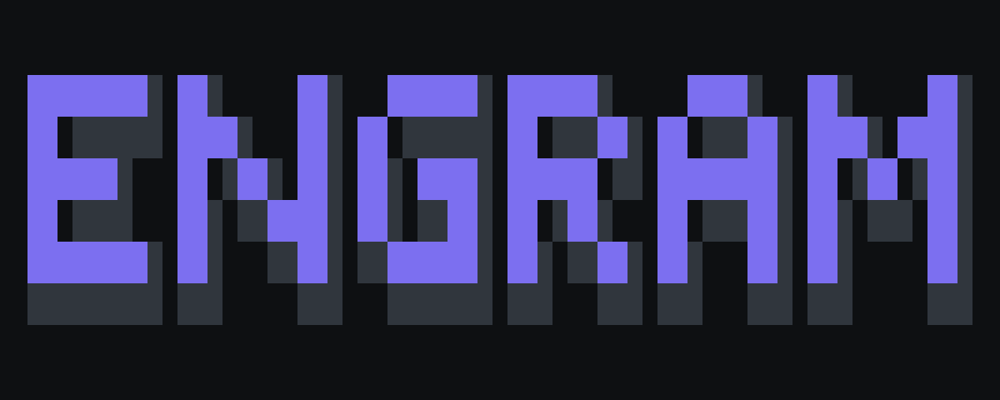

<div align="center">

<p></p>

# Engram

あなたを覚えているリサーチアシスタント。小さな Web サービスとして動かします：質問すると答えが流れ出てきて、翌日戻ってきても、何をしていたかを覚えています——サービスを再起動しても、高速キャッシュを消しても。

[](LICENSE)
[](https://www.python.org/)
[](https://fastapi.tiangolo.com/)
[](https://github.com/langchain-ai/langgraph)
[](https://redis.io/)
[](https://www.postgresql.org/)
[](https://www.docker.com/)

[简体中文](README.zh-CN.md) · [English](README.md) · 日本語

</div>

---

## 機能

- **リアルタイムチャット** —— 推論・検索・回答がその場で見える。読み込みアイコンを眺めなくていい
- **リサーチモード** —— ひとつの質問がストリーミングレポートになり、いつでも読み返せる
- **長期記憶** —— セッションは再起動に耐える。高速キャッシュを消しても何も失わない
- **切断しても失わない** —— 接続が切れても、止まったところから続きを再開できる
- **ターミナルでも使える** —— フルスクリーン TUI と CLI を同梱（`engram`）

## Demo

## インストール

Python 3.12+ と DeepSeek の API キーが必要です（OpenAI 互換なら他社でも可）。

```bash
git clone https://github.com/Jeson-Chan/Engram.git
cd Engram
pip install -e ".[dev]"
```

## クイックスタート

```bash
engram
```

初回起動時に API キーを尋ねます（先に `engram init` でも可）。以上——
TUI は自己完結：対話・メモリ・Skill はすべてプロセス内で動き、バックエンド
も Docker も不要です。`engram doctor` はオプションのヘルスチェック
（能力マトリクス + 接続性）。

コックピット内：

| キー | 操作 |
|---|---|
| `Ctrl+K` | セッション切替 / 新規セッション |
| `Ctrl+O` | Run タイムライン（履歴 + 永続イベント） |
| `Ctrl+G` | Memory パネル（hot/cold/forgotten カウント） |
| `Ctrl+U` | Inspector（モデル/モード/能力 + 実行環境） |
| `Esc` | オーバーレイを閉じる |

## Web ワークベンチ

フロントエンドを一度ビルドし、バックエンドの起動方法を選びます。
どちらでも動きます；違いはメモリ階層と設定変更の反映方法です。

```bash
cd web
npm install
npm run build
cd ..
```

### ローカルバックエンド（venv）

Python 環境で実行。メモリはデフォルトで Markdown 単層；階層化するには
Redis/PG を設定（TUI の `/guide` に案内ステップあり）。`.env` の変更は
ゲートウェイ再起動で反映。

bash / zsh：

```bash
ENGRAM_WEB_UI_ENABLED=true python -m engram.backend.app.gateway --port 8000
```

PowerShell：

```powershell
$env:ENGRAM_WEB_UI_ENABLED = "true"
python -m engram.backend.app.gateway --port 8000
```

cmd：

```cmd
set ENGRAM_WEB_UI_ENABLED=true
python -m engram.backend.app.gateway --port 8000
```

### Docker バックエンド

```bash
docker compose up -d
```

メモリ階層（Redis ホット / Postgres コールド）は compose が注入——
`.env` に DSN は不要。設定変更はコンテナ再ビルド
（`docker compose up -d --build`）が必要：イメージにコードが焼き込まれ、
階層 DSN は常に compose が `.env` より優先。

どちらの方式でも `http://localhost:8000/app` で利用できます。

## 既知の制限

- 内蔵 `web_search`（DuckDuckGo）は DuckDuckGo へのアウトバウンド接続が必要で、制限されたネットワークでは結果が空になります。リサーチフローはこれに依存しません——ローカルサンドボックスとシード済みメモリを使います。
- Docker サンドボックスは任意です。`agent-sandbox` 未インストール時は `LocalSandboxProvider` を使います。

## ライセンス

[MIT](LICENSE)
