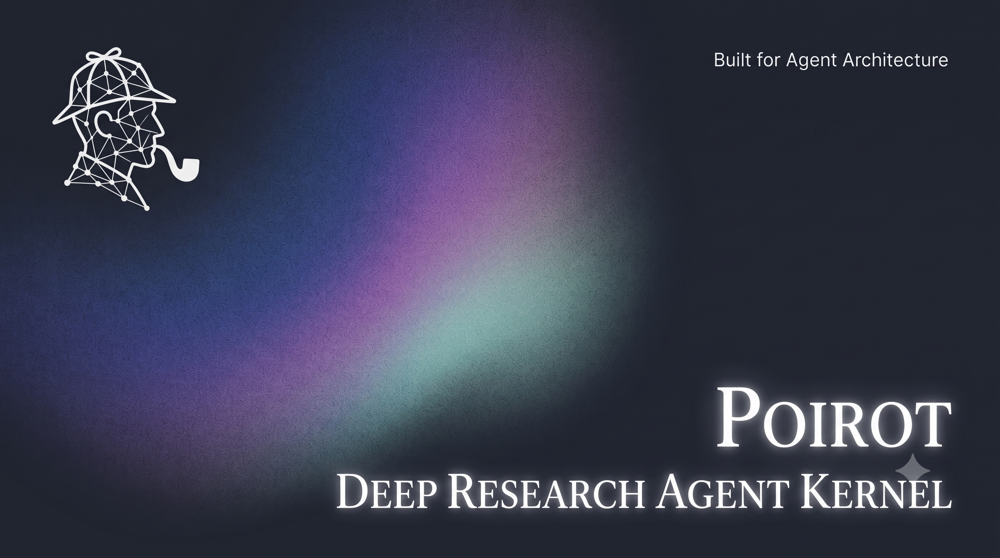
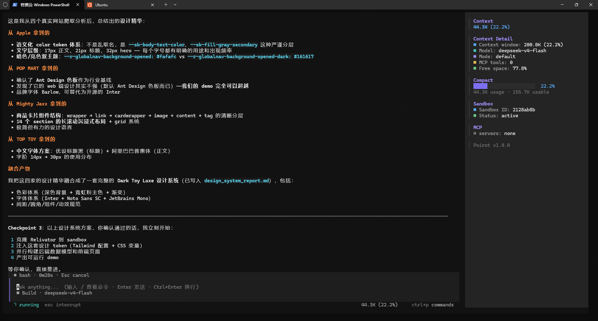
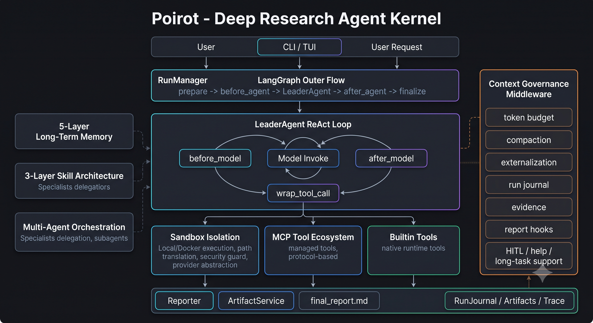

<div align="center">



### A Deep Research Agent Kernel with Long-Term Memory — served over HTTP

[](LICENSE)
[](https://www.python.org/)
[](https://github.com/langchain-ai/langgraph)
[](https://fastapi.tiangolo.com/)
[](https://redis.io/)
[](https://www.postgresql.org/)

**📚 Docs:** [Usage (EN)](USAGE.md) · [使用指南 (中文)](resource/USAGE.zh-CN.md) · [Demo Script](docs/demo.md) · [Design Notes](docs/interview-notes.md)

<sub>Sessions · SSE Streaming · Tiered Memory (Redis hot / Postgres cold) · Stream Consolidation · Reconnect Resume</sub>

</div>

---

## Demo

**Act 1 — the agent remembers across sessions.** Wipe the entire hot tier ("forget everything recent") and the agent still recalls the thread of the research — the Postgres cold tier answers, and the recalled memory goes warm again:

```bash
$ docker compose exec redis redis-cli FLUSHDB      # simulate: hot cache gone
OK
$ curl -N -X POST localhost:8000/sessions/$SID/chat \
    -H "Content-Type: application/json" \
    -d '{"message": "继续上次的研究——缓冲设计定了吗？"}'

event: answer
data: {"type": "answer", "content": "上次已确认 Last-Event-ID 方案；缓冲采用 per-session 环形……"}
# ^ recalled from the cold tier (back-filled into the hot tier on the way out)
```

**Act 2 — streaming research that survives a dropped connection.** Submit a question, watch tokens stream; if the connection drops, reconnect with the last frame id and the missed frames replay first:

```bash
$ curl -N -X POST localhost:8000/sessions/$SID/research -d '{"message": "..."}'
event: thinking   data: {...}     # reasoning deltas
event: answer     data: {...}     # token deltas
event: tool_start data: {...}     # tool calls
event: done       data: {...}     # termination

# connection dropped at frame 5? reconnect and nothing is lost:
$ curl -N -H "Last-Event-ID: 5" -X POST .../chat -d '{"message": "..."}'
id: 6  ...  id: 7  ...           # the gap replays, then the live tail continues
```

<div align="center">



<sub>TUI conversation view — same kernel, local interactive mode</sub>

</div>

Both acts as a walkable curl-level script (plus the kill-the-consumer Stream replay in `redis-cli`): **[docs/demo.md](docs/demo.md)**

---

## What is Engram

Engram is a deep research agent — a ReAct kernel with middleware-first architecture, five-layer long-term memory, sandbox isolation and skill evolution — **wrapped as a long-running service**: a FastAPI gateway that streams agent output over SSE, keeps sessions alive across restarts in Postgres, and remembers users over time in a two-tier store.

```text
POST /sessions                →  per-session thread_id (the state-isolation key everything scopes on)
POST /sessions/{id}/chat     →  SSE stream: thinking / answer / tool events, frame ids, resume
POST /sessions/{id}/research →  SSE research stream + PG run record + report artifact
GET  /sessions/{id}/runs     →  run history (survives restarts)
GET  /runs/{run_id}/report   →  the final report markdown
GET  /docs                   →  live Swagger playground
```

The same binary also runs locally as a TUI / CLI for interactive research — one kernel, two faces.

**2763 tests** guard the kernel and the service; CI runs the recovery / replay / fallback suites against real Redis + Postgres service containers.

---

## Why it is built this way

The interesting part of this project is not the feature list — it is the decisions. Six of them:

| Decision | Why |
|---|---|
| **The gateway never calls the sync entry (`LeaderAgent.run`)** | It runs `asyncio.run` internally — nested inside the ASGI event loop it raises immediately. The gateway wraps the `graph.astream` async generator instead; every blocking IO (journal JSONL, run records, report writes) rides `asyncio.to_thread`, so the event stream never freezes. |
| **Memory is two tiers: Redis hot / Postgres cold** | Hot = fast and *evicting* (per-trace TTL, refreshed on read — frequently recalled memories stay warm); cold = durable sediment, written **first**. A hot-miss falls through to cold and back-fills the hot tier — `FLUSHDB` is an inconvenience, not data loss. |
| **Consolidation runs on a Redis Stream consumer group** (not pub/sub, not a list) | Consolidation needs **at-least-once**. Streams give the full trio: group offset (resume), PEL (failed entries replay), `XAUTOCLAIM` (crashed consumers' orphans reclaimed, min-idle-time so in-flight work isn't stolen). Pub/sub drops on disconnect; a list has no consumer offset. |
| **SSE frames carry ids** | The reconnect story becomes the *same mental model as the Stream*: client-held offset (`Last-Event-ID`) + server-side gap replay, at-least-once on both sides. Gaps older than the buffer degrade honestly (in-stream error + `X-Engram-Events-Dropped` header). |
| **LangGraph state persists via a PG checkpointer** | Restart the service, the session continues; two uvicorn workers see the same session state. Multi-worker isn't configured into existence — it falls out of the storage model. |
| **Tests assert external behavior through injected seams** | The runtime factory, stores and graphs are injectable, so tests never touch a real LLM provider; the suites that do need Redis/PG run live in CI and skip honestly when absent. |

The full talking-points version (with the follow-up-question depth): **[docs/interview-notes.md](docs/interview-notes.md)**

---

## Installation

**Prerequisites**

- Python **3.12+**
- An LLM API key — `DEEPSEEK_API_KEY` (default), or any OpenAI-compatible provider
- Docker (only for the full-stack path; the local path needs nothing else)

**A. Full stack (agent + redis + postgres, one command)**

```bash
git clone <repo-url> && cd Engram
cp .env.example .env          # fill in DEEPSEEK_API_KEY
docker compose up
```

**B. Local (CLI / TUI, zero infrastructure)**

```bash
git clone <repo-url> && cd Engram
python -m venv .venv
.venv\Scripts\activate            # Windows   (source .venv/bin/activate on Linux/macOS)
pip install -e ".[dev]"
cp .env.example .env           # fill in DEEPSEEK_API_KEY
```

---

## Quick Start

**Service mode — first stream in 30 seconds:**

```bash
export SID=$(curl -s -X POST localhost:8000/sessions | python -c "import sys,json;print(json.load(sys.stdin)['session_id'])")

curl -N -X POST localhost:8000/sessions/$SID/chat \
    -H "Content-Type: application/json" \
    -d '{"message": "研究：SSE 断线重连的主流方案"}'
```

```text
event: thinking   data: {"type": "thinking", "content": "…"}   ← reasoning deltas
event: answer     data: {"type": "answer",   "content": "…"}   ← token deltas
event: tool_start data: {"type": "tool_start", "tool_name": "web_search", …}
event: tool_end   data: {"type": "tool_end",   "tool_result": "…"}
event: done       data: {"type": "done"}                        ← always terminates with done
```

Explore the rest at **http://localhost:8000/docs** (Swagger), or pull the research report afterwards:

```bash
curl -s localhost:8000/sessions/$SID/runs          # run history
curl -s localhost:8000/runs/<run_id>/report        # final report (markdown)
```

**Local mode:** just run `engram` — full-screen TUI; type a question, `/` for commands.

Advanced toggles (memory consolidation cadence, skill evolution, multi-agent, Docker sandbox, MCP) live in [.env.example](.env.example) — every switch is one env var, documented in the [Usage Guide](USAGE.md).

---

## How it works

<div align="center">



</div>

<sub>Outer flow: `prepare → before_agent → LeaderAgent (ReAct loop) → after_agent → finalize`. 21 middleware cross-cut every hook — memory recall in `before_model`, consolidation submit in `after_model`, skill injection, sandbox lifecycle, tool pairing. The `app → agents` dependency is strictly one-directional.</sub>

**One request, end to end** (service mode):

```text
startup (lifespan, once):  PG checkpointer → run store → model routing → MCP → skills → graph compiled
POST /sessions:           SessionRegistry allocates an independent thread_id    ← every agent-side state scopes on it
POST .../chat:             EngramStreamClient(graph.astream) → SSE frames (id: N) → per-session buffer
                            journal / run-record IO → asyncio.to_thread          ← event loop never blocks
after_model:               consolidation event XADD → Redis Stream (persistent)
consumer group:            XREADGROUP → handle → XACK        (failure → PEL → XAUTOCLAIM replay)
reconnect:                 Last-Event-ID → buffer gap replay → live tail
```

**The five-layer memory** (each layer independently tested):

| Layer | Role | The interesting part |
|---|---|---|
| **L1 Schema** | `MemoryTrace` frozen dataclass, 5 atomic ops | tools have no LLM — pure data operations |
| **L2 Strategies** | Ebbinghaus decay + composite forget | *lazy* decay — strength computed at retrieve time, zero background jobs |
| **L3 Tiered store** | Redis hot (partitioned keys, TTL) / PG cold (sediment) / Markdown fallback | cold-first writes; hot-miss → cold → back-fill; read-refresh keeps hot memories hot |
| **L4 Middleware** | recall injection into the model call | injected as a per-call `HumanMessage` — the prompt-cache prefix stays intact |
| **L5 Consolidation** | Redis Stream producer/consumer group | at-least-once via offset + PEL + XAUTOCLAIM; Web restarts lose nothing |

Also in the kernel (kept from the research core): multi-agent delegation with a **shared thread sandbox**, Docker sandbox with **path enforcement** (agent writes must land in the mounted area), MCP tool ecosystem with fallback chains, and a three-layer **skill evolution** loop (mutation gated by eval, ratchet rollback on degradation). See the [Usage Guide](USAGE.md) for the full tour.

**More reading:** [Demo script](docs/demo.md) · [Design notes / talking points](docs/interview-notes.md) · [Usage (EN)](USAGE.md) · [使用指南 (中文)](resource/USAGE.zh-CN.md)

---

## Tech Stack

<div align="center">


</div>

---

## Acknowledgments

Engram stands on the shoulders of giants. The middleware-first agent architecture, the cognitive-science memory model (episodic / semantic / procedural with Ebbinghaus decay), multi-agent delegation patterns, sandbox isolation with path enforcement, and skill self-evolution with eval gating draw on ideas from the open-source agent ecosystem and cognitive-science research. The service layer (FastAPI/SSE, tiered storage, Stream-based consolidation) is designed and tested from first principles. We gratefully acknowledge the developers and researchers whose work made Engram possible.

---

## License

[MIT](LICENSE) © Engram Authors

---

<div align="center">

<sub>Built for those who care about how agents are built.</sub><br>
<sub>If this project helps you, a ⭐ is appreciated.</sub>

</div>
