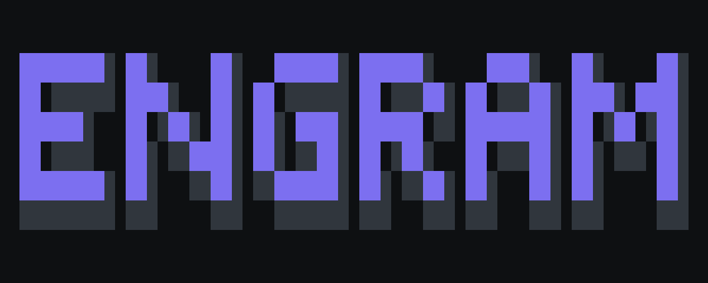

<div align="center">

<p></p>

# Engram

一个记得住你的研究助手。它作为一个小型 Web 服务跑起来：提一个问题，看着答案流出来；隔天再回来，它还记得你们在聊什么，服务重启过、快缓存清空过，都没关系。

[](LICENSE)
[](https://www.python.org/)
[](https://fastapi.tiangolo.com/)
[](https://github.com/langchain-ai/langgraph)
[](https://redis.io/)
[](https://www.postgresql.org/)
[](https://www.docker.com/)

简体中文 · [English](README.md) · [日本語](README.ja.md)

</div>

---

## 功能特性

- **实时对话** —— 推理和搜索的过程、答案文本，边发生边显示，不用对着加载图标干等
- **研究模式** —— 一个问题变成一份流式报告，随时回来翻看
- **长期记忆** —— 会话经得起重启；快缓存清空了也不丢东西
- **断线不丢进度** —— 连接断了，重连接着上次的位置继续
- **也能在终端用** —— 自带全屏 TUI 和 CLI（`engram`）

## Demo

## 安装

需要 Python 3.12+ 和一个 DeepSeek API key（任何 OpenAI 兼容服务也行）。

```bash
git clone https://github.com/Jeson-Chan/Engram.git
cd Engram
pip install -e ".[dev]"
```

想手工编辑配置？`cp .env.example .env` 仍然可用；完整变量参考见自动生成的
[`docs/configuration.md`](docs/configuration.md)。

## 快速开始

干净仓库三步走：

```bash
engram init              # 1. 探测本机环境，问密钥 + MCP/沙箱授权，写出 .env
docker compose up -d     # 2. 网关(8000) + postgres + redis + 巩固 worker
engram doctor            # 3. 能力矩阵 + 连通性（on / off / broken）
```

`engram init` 只写显式值：密钥、两个权力授予开关（MCP 与沙箱，未同意保持关闭）、
以及探测结论。其余变量都有安全默认值；DSN 一律不进 `.env`，由 compose 注入。

### 终端（TUI）

```powershell
engram                          # 或 python -m engram.backend.app.cli.main
```

直接提问。驾驶舱里：

| 快捷键 | 作用 |
|---|---|
| `Ctrl+K` | 会话切换 / 新建会话 |
| `Ctrl+O` | Run 时间线（运行历史 + 持久事件） |
| `Ctrl+G` | Memory 面板（热/冷/遗忘计数） |
| `Ctrl+U` | Inspector（模型/模式/能力——与 `engram doctor` 同一份报告） |
| `Esc` | 关闭任何弹层 |


### Web 工作台

```powershell
cd web; npm install; npm run build    # 一次性构建前端
$env:ENGRAM_WEB_UI_ENABLED="true"; python -m engram.backend.app.gateway --port 8000
```

用 compose 时 `ENGRAM_WEB_UI_ENABLED` 已由 compose 注入，工作台在
`http://localhost:8000/app`。


### Docker Agent

```bash
docker compose run --rm agent   # 容器里跑 TUI
```

## 已知限制

- 内置 `web_search`（DuckDuckGo）需要出网访问 DuckDuckGo；受限网络下返回空结果。研究链路不依赖它——使用本地沙箱与预置记忆。
- Docker sandbox 为可选项；未安装 `agent-sandbox` 时网关使用 `LocalSandboxProvider`。

## 许可证

[MIT](LICENSE)
